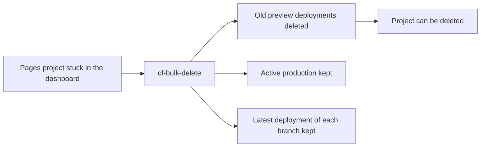

<div align="center">

# Your project has too many deployments to be deleted

Cloudflare will not delete the Pages project. This deletes the deployments.

[](https://www.npmjs.com/package/cloudflare-bulk-delete)
[](https://www.npmjs.com/package/cloudflare-bulk-delete)
[](https://nodejs.org/)
[](LICENSE)

</div>

The dashboard dialog links to [a Wrangler guide](https://cfl.re/3CXesln). That guide is a loop: list IDs, delete one, repeat, and skip the one Cloudflare refuses. `cf-bulk-delete` runs that loop with a dry run and the protections Cloudflare actually enforces.

```text
dashboard                         cf-bulk-delete
─────────                         ──────────────
project stuck                     old deployments gone
100+ deployments                  production left in place
delete button dead                latest of each branch left in place
```

## Sixty seconds

```bash
npm install -g cloudflare-bulk-delete

export CLOUDFLARE_API_TOKEN=your_token
export CLOUDFLARE_ACCOUNT_ID=your_account_id

cf-bulk-delete delete pages my-project --dry-run
cf-bulk-delete delete pages my-project
```

The first delete only prints the plan. The second one talks to the API.

Need the click-through version:

```bash
cf-bulk-delete interactive
```

Token permissions are Pages Write and Workers Scripts Write. The dashboard often labels those Edit. [Open the prefilled token form](https://dash.cloudflare.com/profile/api-tokens?permissionGroupKeys=%5B%7B%22key%22%3A%22page%22%2C%22type%22%3A%22edit%22%7D%2C%7B%22key%22%3A%22workers_scripts%22%2C%22type%22%3A%22edit%22%7D%5D&accountId=%2A&zoneId=all&name=Cloudflare+Bulk+Delete), or print the same link later with `cf-bulk-delete token-template`.

The account ID sits in the dashboard sidebar under API. It is 32 hex characters. It is not the zone ID.

## What stays

Cloudflare rejects some deletes even with `force=true`. The tool skips those up front and treats a late rejection as skipped, not failed.

| Target | Default |
| --- | --- |
| Pages production deployments | kept |
| Newest Pages deployment overall | kept (`--keep-latest 1`) |
| Newest deployment of each branch | kept, always |
| Aliased preview deployments | deleted (`force=true`) |
| Worker deployment serving traffic | kept |
| Older Worker deployments | deleted |
| Worker versions | not deletable with an API token |

A Worker version is the uploaded snapshot. A deployment only decides which snapshot gets traffic. As of 2026 the versions API rejects `DELETE` for an API token. Rollback still covers the latest 100 versions. This tool does not pretend it can prune that history.



## Commands

```bash
cf-bulk-delete list
cf-bulk-delete deployments pages my-project
cf-bulk-delete delete pages my-project --dry-run
cf-bulk-delete delete pages my-project --environment preview --max-age 7
cf-bulk-delete delete pages my-project --skip-production false --keep-latest 0
cf-bulk-delete delete workers my-script --dry-run
cf-bulk-delete destroy pages my-project
```

`destroy` removes the whole project or script. It asks you to type the name.

| Flag | What it does |
| --- | --- |
| `--dry-run` | Print the plan. Delete nothing. |
| `--max-age <days>` | Only consider deployments older than this. |
| `--environment <env>` | Pages only. `production` or `preview`. |
| `--skip-production false` | Include Pages production deployments. Default is to skip them. |
| `--keep-latest <n>` | Also protect the newest n Pages deployments. Default is 1. Use `0` to turn that off. |
| `--force` / `--no-force` | `force` deletes aliased non-production deployments. It is on by default. |
| `--batch-size <n>` | Smaller batches if the API starts answering 429. |
| `-y, --yes` | Skip the confirmation prompt. |

`--no-skip-production` is not a flag. Commander will suggest the wrong thing. The working form is `--skip-production false`. Same for the count: `--keep-latest 0`, not `--keep-latest=0`.

## From JavaScript

```javascript
import { ServiceManager } from 'cloudflare-bulk-delete';

const manager = new ServiceManager(apiToken, accountId);
const deployments = await manager.listDeployments('pages', 'my-project');

const result = await manager.bulkDeleteDeployments('pages', 'my-project', deployments, {
  skipProduction: true,
  keepLatest: 1,
  dryRun: true
});
```

## VS Code

The extension lives in [`vscode/`](vscode/). One VSIX, no OS or CPU lock.

```bash
npm run vscode:package
code --install-extension vscode/cloudflare-bulk-delete-vscode-*.vsix
```

The 1.4.0 package is also attached to the [GitHub release](https://github.com/RamaAditya49/cloudflare-bulk-delete/releases/tag/v1.4.0). Marketplace publishing is a separate manual step.

## When it still complains

**Invalid API token.** The token needs Account Pages Write and Account Workers Scripts Write, on the right account. `cf-bulk-delete token-template` prints the form again.

**Cannot delete an aliased deployment.** Leave the default `--force` on. `--no-force` keeps aliases. Force still cannot remove the active production deployment or the latest deployment of a branch.

**Too many deployments, project still stuck.** Cloudflare documents this once a Pages project is over about 100 deployments. Clear the old ones, then delete the project. The live production deployment and the latest deployment of each branch remain.

**Worker versions are still there.** Expected. Historical deployments can go. Versions cannot, not with an API token.

**429.** The client already waits between calls. Drop `--batch-size` to 5.

**Account ID not found.** Copy the account ID, not the zone ID.

```bash
LOG_LEVEL=debug cf-bulk-delete list
```

## Install

Node.js 22.14 or newer.

```bash
npm install -g cloudflare-bulk-delete
pnpm add -g cloudflare-bulk-delete
bun add -g cloudflare-bulk-delete
```

Put the credentials in the shell or in a `.env` file next to where you run the command:

```bash
CLOUDFLARE_API_TOKEN=your_token
CLOUDFLARE_ACCOUNT_ID=your_account_id
```

MIT. [Rama Aditya](https://github.com/RamaAditya49).
